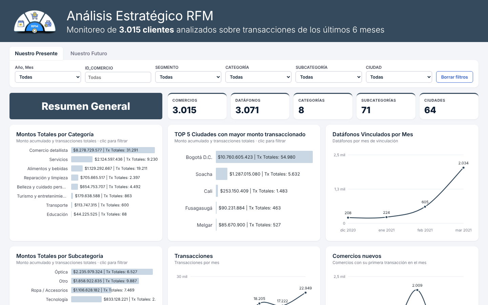
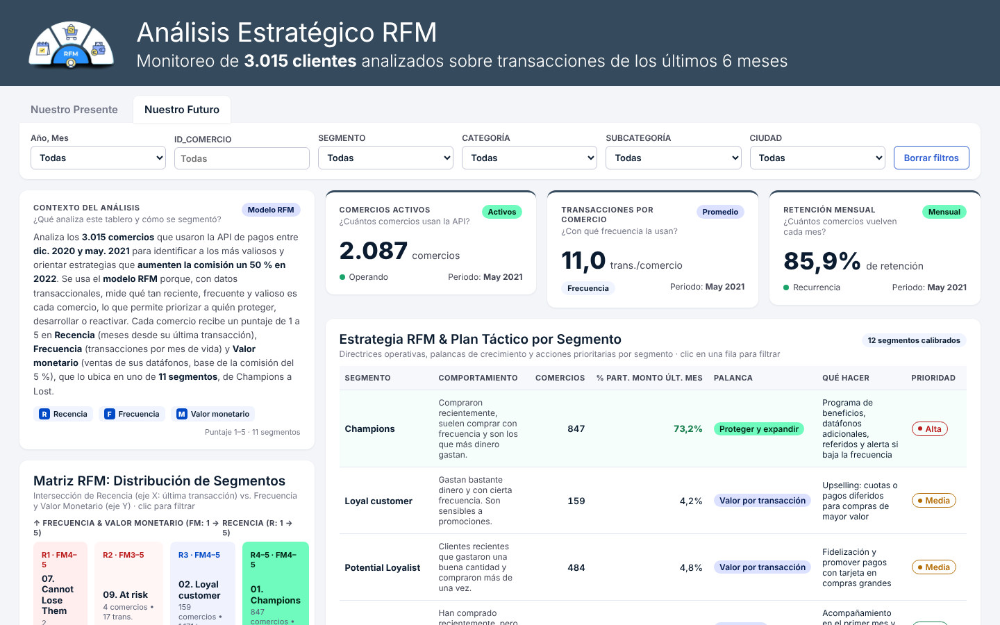

# Análisis Estratégico RFM · Segmentación de comercios

Tablero interactivo que segmenta **3.015 comercios** usuarios de una API de pagos según su comportamiento transaccional (dic. 2020 – may. 2021) y propone un plan táctico por segmento para **aumentar la comisión un 50 % en 2022**.

**[▶ Ver el tablero en vivo](https://Sebastian6820.github.io/rfm-segmentacion-comercios/)**



## El problema

La empresa cobra una comisión del 5 % sobre las ventas que los comercios procesan con sus datáfonos. Para crecer esa comisión hay que saber a quién proteger, a quién desarrollar y a quién reactivar. Con datos solo transaccionales, el modelo **RFM** es la forma más directa de responderlo.

## Metodología

| Dimensión | Cómo se midió | Puntaje |
|---|---|---|
| **R**ecencia | Meses desde la última transacción | 1 – 5 |
| **F**recuencia | Transacciones por mes de vida del comercio | 1 – 5 |
| **M**onetario | Ventas de sus datáfonos (base de la comisión) | 1 – 5 |

La combinación de puntajes ubica a cada comercio en uno de **11 segmentos**, de *Champions* a *Lost*. Cada segmento tiene una palanca de crecimiento, acciones concretas y una prioridad.

## Hallazgos principales

- **Concentración extrema:** los 847 *Champions* generan el **73,2 %** del monto del último mes. Protegerlos es la prioridad uno.
- **Retención mensual del 85,9 %** y 11 transacciones promedio por comercio activo en mayo 2021.
- **Bogotá** concentra la mayor parte del monto transaccionado; *Comercio detallista* es la categoría dominante.
- La vinculación de datáfonos se aceleró desde febrero 2021 (de ~600 a más de 2.000 en marzo), lo que explica el volumen de *New Customers* y *Promising* a cuidar en el primer mes.



## Qué incluye el tablero

- **Nuestro Presente:** KPIs generales, montos por categoría, subcategoría y ciudad, datáfonos vinculados, transacciones y comercios nuevos por mes.
- **Nuestro Futuro:** contexto del análisis, KPIs de actividad, frecuencia y retención, matriz RFM (Recencia × Frecuencia/Monetario) y plan táctico por segmento.
- **Filtros cruzados:** año-mes, ID de comercio, segmento, categoría, subcategoría y ciudad. Hacer clic en barras, celdas de la matriz o filas de la tabla filtra todo el tablero.

## Tecnología

HTML, CSS y JavaScript sin librerías. Los datos van embebidos y agregados en el propio archivo y los gráficos se dibujan en SVG, así que el tablero funciona abriendo `index.html`, sin servidor ni instalación.

```
rfm-segmentacion-comercios/
├── index.html      # Tablero completo (datos + lógica + estilos)
├── assets/         # Capturas para este README
└── README.md
```

## Sobre los datos

Los comercios están identificados con códigos alfanuméricos anonimizados; el conjunto no incluye nombres, NIT ni datos personales.

## Autor

**Sebastián** · [GitHub](https://github.com/Sebastian6820) · [LinkedIn](https://www.linkedin.com/in/sebastianmartineztinoco-dataanalyst~)
